# 🐾 PetFlow AI — Assistente inteligente para clínica veterinária

Assistente que recebe as mensagens dos tutores, usa **Inteligência Artificial (Gemini)** para entender e classificar cada uma e, com o **n8n**, encaminha o atendimento automaticamente para o setor certo da clínica.

---

## 1. Apresentação da Ideia

Clínicas veterinárias pequenas costumam concentrar todo o atendimento em uma recepção que responde WhatsApp, e-mail e redes sociais ao mesmo tempo. No meio de pedidos de banho e tosa, dúvidas sobre horários e perguntas sobre preços, chegam mensagens de tutores com o animal passando mal, e todas entram na mesma fila.

A ideia do **PetFlow AI** surgiu desse contraste: a mesma caixa de entrada mistura assuntos simples e situações que não podem esperar. Um assistente que lê cada mensagem, entende o assunto e a urgência e já entrega o atendimento ao setor responsável tira trabalho repetitivo da recepção e faz os casos graves chegarem mais rápido à equipe veterinária.

O projeto é fictício e foi desenvolvido como desafio prático de fundamentos de IA, engenharia de prompts, integração com APIs e automação.

## 2. Problema Escolhido

Caso escolhido: **4.1 — Classificação de Mensagens**.

Hoje, na clínica fictícia, uma pessoa precisa:

1. ler cada mensagem;
2. descobrir do que se trata;
3. decidir qual setor deve responder;
4. repassar manualmente.

Isso consome tempo, gera erros de encaminhamento e não diferencia urgência: um animal envenenado pode esperar na fila atrás de um pedido de orçamento.

O sistema precisa classificar as mensagens nas categorias abaixo e encaminhar cada uma ao destino correspondente:

| Categoria | Destino |
|---|---|
| Agendamento | Recepção |
| Sintomas / possível urgência | Equipe veterinária |
| Dúvidas sobre serviços | Atendimento |
| Vacinação e exames | Recepção / Equipe veterinária |
| Reclamações | Gerência |
| Financeiro | Administrativo |

## 3. Solução Proposta

O tutor escreve a mensagem em uma página web. A mensagem vai para uma **API**, que pede ao **Gemini** uma classificação estruturada em JSON. A API valida essa resposta, define o setor e a prioridade e envia o atendimento para um fluxo do **n8n**, que dispara alertas de urgência, coloca o atendimento na fila do setor e devolve um ticket.

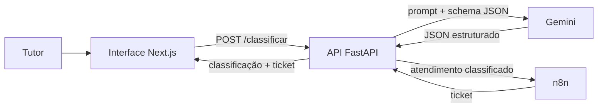

**Como a IA participa**

A IA é responsável pela parte que exige interpretação de linguagem natural. Para cada mensagem, o Gemini devolve:

- **categoria** (uma das seis);
- **urgência** (`baixa`, `media`, `alta` ou `emergencia`);
- **confiança** da classificação (0 a 1);
- dados extraídos: nome do tutor, nome do pet, espécie e sintomas citados;
- **resumo** da solicitação;
- **ação sugerida** para o setor;
- **resposta sugerida** ao tutor, cordial e sem diagnóstico.

**O que fica fora da IA (regras no código)**

Para o sistema ser previsível, algumas decisões não dependem do modelo:

- **Setor de destino:** definido por uma tabela fixa a partir da categoria; a IA não escolhe o nome do setor.
- **Prioridade:** P1 a P4, calculada a partir da urgência.
- **Regra de segurança:** termos como "convulsão", "atropelado" ou "envenenado" forçam emergência e envio à equipe veterinária, mesmo que o modelo subestime.
- **Revisão humana:** marcada quando a confiança é menor que 0,6.
- **Alerta veterinário:** ligado quando há urgência alta em agendamentos, vacinas/exames ou sintomas.

## 4. Tecnologias Utilizadas

| Camada | Tecnologia | Uso no projeto |
|---|---|---|
| Inteligência Artificial | **Google Gemini** (`google-genai`) | Classificação e extração de informações em JSON |
| Back-end | **Python 3.12 + FastAPI** | API que recebe a mensagem, chama a IA e envia ao n8n |
| Validação | **Pydantic** | Schema da resposta da IA e da API |
| Automação | **n8n** | Alerta de urgência, roteamento por setor e geração do ticket |
| Interface | **Next.js** (React) | Página para o tutor enviar a mensagem e ver o resultado |
| Configuração | **python-dotenv** | Leitura da chave e das URLs pelo `.env` |

## 5. Funcionamento do Sistema

### 5.1 Como a API recebe os dados

A interface (ou qualquer cliente HTTP) envia um `POST /classificar`:

```json
{
  "mensagem": "Minha gata Luna está vomitando desde ontem e não quer comer nada. O que eu faço?",
  "canal": "whatsapp",
  "remetente": "Carlos"
}
```

O FastAPI valida a entrada com Pydantic: a mensagem precisa ter entre 3 e 2.000 caracteres. Mensagens idênticas recebidas em até 5 minutos reaproveitam a classificação em cache, sem nova chamada à IA.

| Método | Rota | Descrição |
|---|---|---|
| GET | `/` | Status, modelo, modo simulado e se o n8n está configurado |
| GET | `/categorias` | Categorias e setores de destino |
| POST | `/classificar` | Classifica a mensagem, envia ao n8n e devolve tudo |
| DELETE | `/cache` | Limpa o cache |

### 5.2 Como a IA processa as informações

O prompt (`prompts.py`) foi montado em blocos:

1. **Papel:** assistente de triagem que só classifica, sem diagnosticar.
2. **Definição de cada categoria**, com exemplos do que entra em cada uma.
3. **Regras de desempate:** se há sintoma, vale "Sintomas" mesmo que o tutor peça horário; agendar vacina é "Vacinação e exames".
4. **Critérios de urgência:** o que é `baixa`, `media`, `alta` e `emergencia`.
5. **Regras de extração:** nunca inventar dados (usar `null`) e confiança abaixo de 0,6 quando a mensagem é ambígua.
6. **Segurança:** a mensagem vai entre `<mensagem>` e `</mensagem>` e é tratada só como dado, como proteção contra *prompt injection*.
7. **Exemplos (few-shot)** de entrada e saída.

Para garantir o formato, a chamada ao Gemini usa `response_mime_type="application/json"` e `response_schema=ClassificacaoIA`, com `temperature=0.1`. A resposta ainda é validada pelo Pydantic; se vier fora do formato, a API devolve erro 502 em vez de repassar dados quebrados.

Em seguida, a API aplica as regras do código (setor, prioridade, regra de segurança, revisão humana) e monta a resposta:

```json
{
  "id": "6f1c2a9e-1b7d-4c3e-9a51-0d2f7e8b4c10",
  "classificacao": {
    "categoria": "Sintomas / possível urgência",
    "urgencia": "alta",
    "confianca": 0.93,
    "resumo": "Gata Luna com vômito desde ontem e sem apetite",
    "nome_tutor": null,
    "nome_pet": "Luna",
    "especie": "gato",
    "sintomas": ["vômito", "falta de apetite"],
    "acao_sugerida": "Veterinário deve contatar o tutor hoje e avaliar consulta de urgência",
    "resposta_sugerida": "Sentimos muito pela Luna! Nossa equipe veterinária vai falar com você agora para orientar o atendimento."
  },
  "encaminhamento": {
    "setor": "Equipe veterinária",
    "fila": "equipe_veterinaria",
    "prioridade": "P2 - alta",
    "alerta_veterinario": true,
    "revisao_humana": false,
    "regra_seguranca_acionada": false
  },
  "automacao": {
    "enviado": true,
    "status_http": 200,
    "detalhe": "Encaminhado pelo n8n.",
    "resposta": {
      "status": "encaminhado",
      "fila_destino": "equipe_veterinaria",
      "ticket": "[P2 - alta] Sintomas / possível urgência → Equipe veterinária: Gata Luna com vômito desde ontem e sem apetite",
      "alerta": "🚨 P2 - alta | Gata Luna com vômito desde ontem e sem apetite"
    }
  }
}
```

*(Resposta resumida; ela também traz `recebido_em`, `canal`, `remetente`, `mensagem_original`, `origem` e `cache`.)*

### 5.3 Como a automação é executada

Depois de classificar, a API (`automacao.py`) envia o atendimento para o webhook do n8n. O fluxo `n8n/petflow_workflow.json` executa:

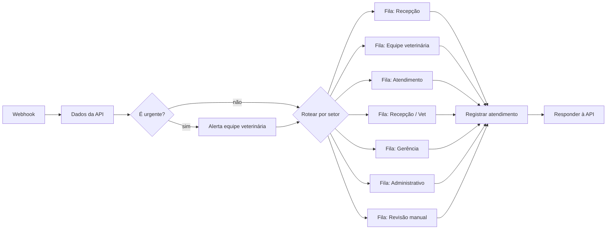

| Nó | Função |
|---|---|
| Webhook - Atendimento classificado | Recebe `POST /webhook/petflow/encaminhar` vindo da API |
| Dados da API | Extrai `id`, `remetente`, `canal`, `classificacao` e `encaminhamento` |
| É urgente? | Verifica `encaminhamento.alerta_veterinario` |
| Alerta: equipe veterinária | Monta o alerta de plantão |
| Rotear por setor | Switch com 6 saídas, uma por setor, mais "Revisão manual" |
| Fila: … | Monta o ticket do setor |
| Registrar atendimento | Marca como encaminhado, com data e hora |
| Responder à API | Devolve `status`, `fila_destino`, `ticket` e `alerta` |

A resposta do n8n volta para a API, que a inclui no campo `automacao`, e a interface mostra o ticket ao tutor. Se o n8n estiver fora do ar, a classificação continua sendo devolvida, com o motivo em `automacao.detalhe`.

Os nós **Fila: …** são o ponto de entrega. Em produção, podem ser trocados por Gmail, Telegram, Discord ou Google Sheets de cada setor.

### 5.4 Documentação visual (prints)

As capturas abaixo mostram uma execução real do sistema com a mensagem *"Quanto custa a castração de uma gata? Dá pra parcelar no cartão?"*, enviada pela tutora Nataly via WhatsApp. A IA classificou como **Financeiro** (urgência baixa, confiança 98%) e o n8n encaminhou para a fila **Administrativo**.

#### Fluxo de automação no n8n

**Visão geral do fluxo**: Webhook → Dados da API → É urgente? → Rotear por setor → filas dos setores → Registrar atendimento → Responder à API.

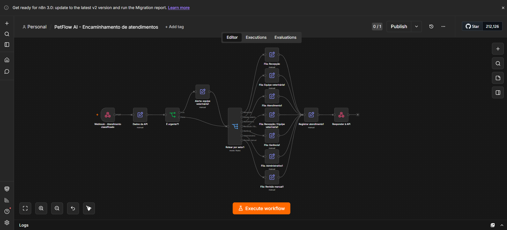

**Execução bem-sucedida**: o caminho percorrido aparece em verde. Como a mensagem não era urgente, ela seguiu pela saída *false* do "É urgente?" e foi para a fila **Administrativo**.

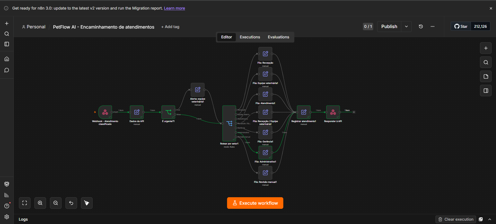

#### Configuração de cada nó

| Nó | Configuração | Print |
|---|---|---|
| **Webhook - Atendimento classificado** | `POST` no caminho `petflow/encaminhar`, respondendo pelo nó *Respond to Webhook*. À direita, o JSON enviado pela API, já com a classificação da IA. | [03-config-webhook.png](docs/prints/03-config-webhook.png) |
| **Dados da API** (Edit Fields) | Extrai do corpo da requisição `id`, `remetente`, `canal`, `mensagem_original`, `classificacao` e `encaminhamento`. | [04-config-editfield1.png](docs/prints/04-config-editfield1.png) |
| **É urgente?** (If) | Condição `{{ $json.encaminhamento.alerta_veterinario }}` *is true*. Nesta execução, o item saiu pela *False Branch*. | [05-config-if.png](docs/prints/05-config-if.png) |
| **Alerta: equipe veterinária** (Edit Fields) | Monta o campo `alerta` com a prioridade e o resumo. Fica sem saída quando a mensagem não é urgente, como neste exemplo. | [06-config-editfiel2.png](docs/prints/06-config-editfiel2.png) |
| **Rotear por setor** (Switch) | Modo *Rules* com 6 regras sobre `encaminhamento.fila`, uma saída por setor, mais a saída extra "Revisão manual". | [07-config-switch.png](docs/prints/07-config-switch.png) |
| **Fila: Administrativo** (Edit Fields) | Define `fila_destino = administrativo` e gera o `ticket` `[P4 - normal] Financeiro → Administrativo: ...`. As outras filas seguem o mesmo modelo. | [08-config-editfield3.png](docs/prints/08-config-editfield3.png) |
| **Registrar atendimento** (Edit Fields) | Acrescenta `status = encaminhado` e `registrado_em` com a data e a hora da execução. | [09-config-editfield4.png](docs/prints/09-config-editfield4.png) |
| **Responder à API** (Respond to Webhook) | Responde em JSON com `status`, `fila_destino`, `ticket`, `alerta` e `registrado_em`, que voltam para a API. | [10-config-respond-webhook.png](docs/prints/10-config-respond-webhook.png) |

<details>
<summary>Ver os prints de configuração</summary>

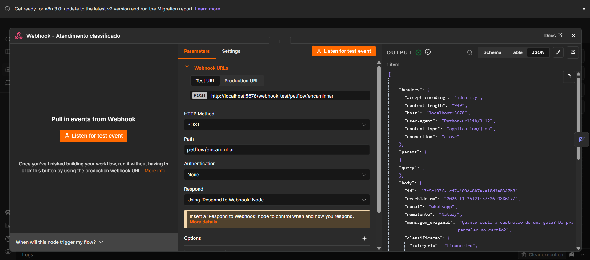
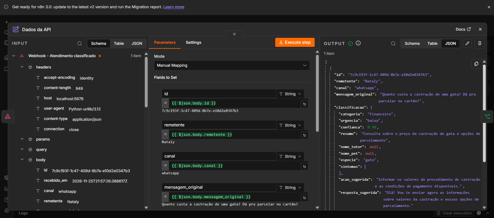
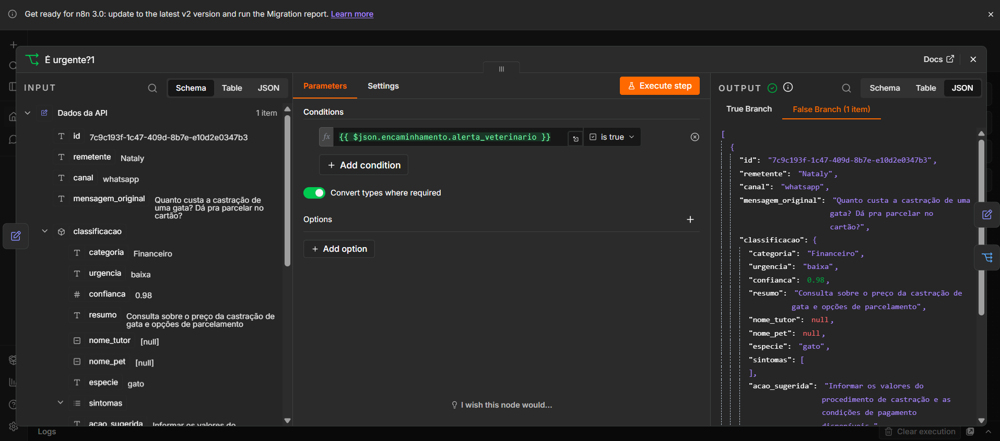
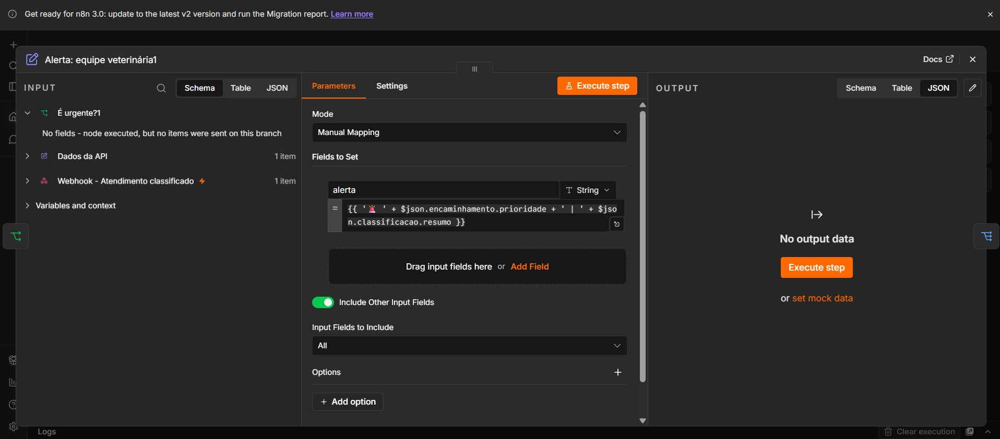
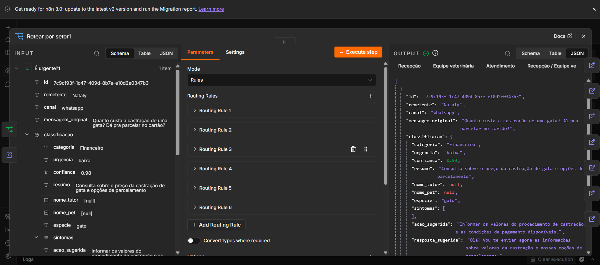
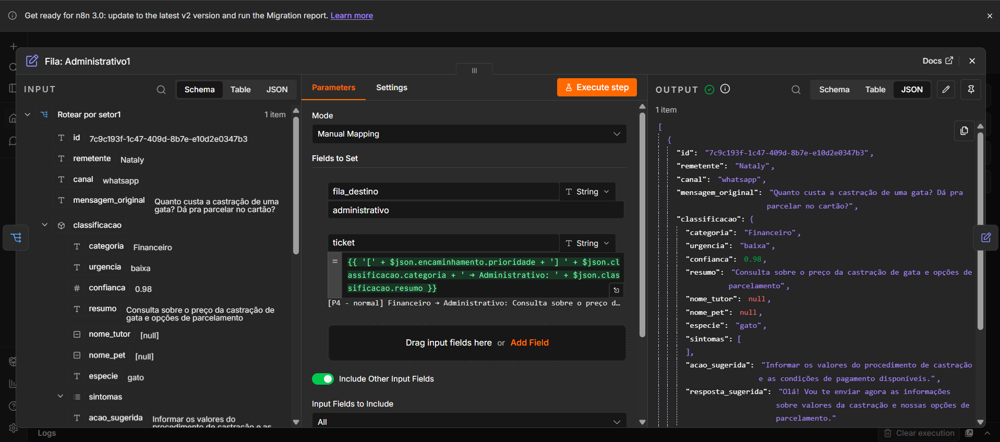
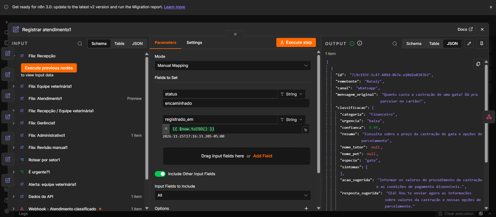
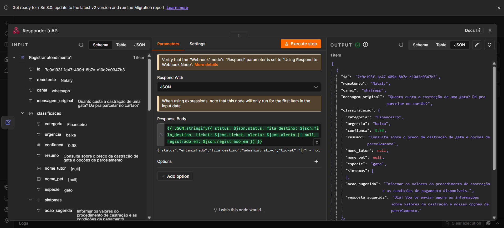

</details>

#### Interface e API

**Interface (Next.js)**: a tutora envia a mensagem e recebe, na mesma tela, a categoria, o setor de destino, a prioridade, a resposta sugerida pela IA e o quadro **Automação n8n**, com o ticket gerado pelo fluxo. O rodapé mostra o caminho percorrido: Interface → API (gemini) → n8n.

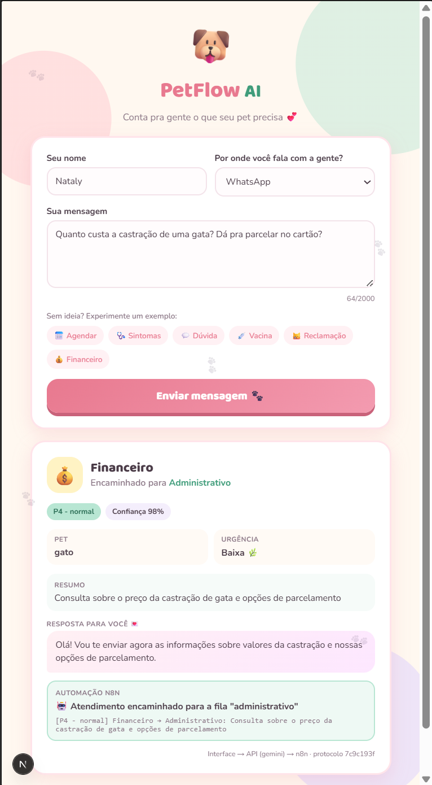

**Documentação da API (Swagger em `/docs`)**: os endpoints `GET /`, `GET /categorias`, `POST /classificar` e `DELETE /cache` e os schemas Pydantic usados para validar a resposta da IA (`ClassificacaoIA`, `Encaminhamento`, `Automacao` e outros).

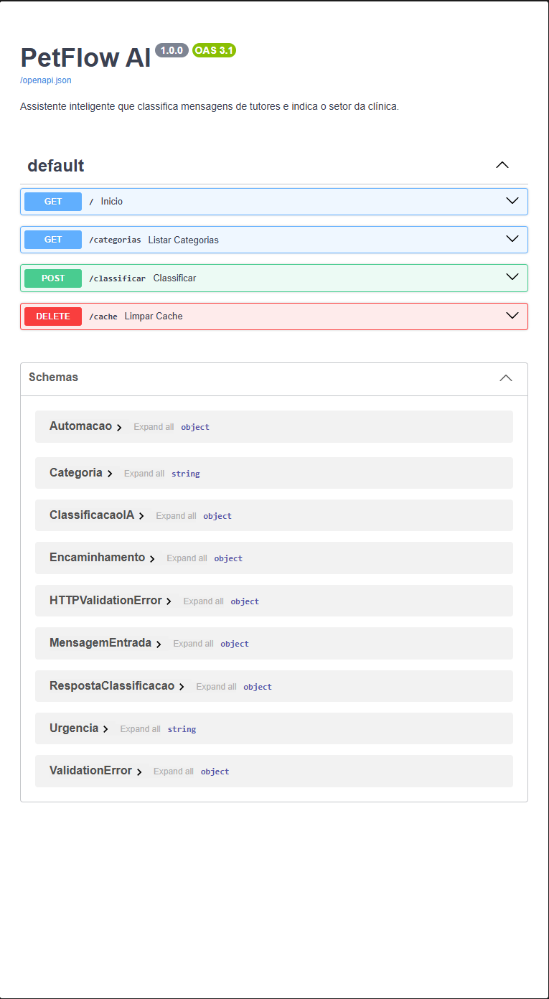

### 5.5 Estrutura do projeto

```
petflowai/
├── server.py              # API FastAPI (endpoints)
├── gemini_service.py      # Integração com o Gemini (saída JSON com schema)
├── prompts.py             # Prompt estruturado (papel, regras, exemplos)
├── schemas.py             # Modelos Pydantic (entrada, saída da IA, resposta)
├── roteamento.py          # Setor, prioridade, regra de segurança, modo simulado
├── automacao.py           # Envia o atendimento classificado para o n8n
├── n8n/
│   └── petflow_workflow.json   # Fluxo do n8n, pronto para importar
├── frontend/              # Interface em Next.js
│   ├── app/page.js             # Página de envio
│   └── app/api/mensagem/route.js  # Repassa a mensagem para a API
├── docs/prints/           # Capturas de tela do fluxo funcionando
├── requirements.txt
└── .env.example
```

## 6. Como Executar

### Pré-requisitos

- Python 3.12+
- Node.js (versão LTS)
- Uma chave da API do Gemini ([Google AI Studio](https://aistudio.google.com/apikey))

São três serviços, cada um em um terminal. A ordem recomendada é **n8n → API → interface**.

### 6.1 n8n (porta 5678)

1. Acesse http://localhost:5678 e crie a conta local.
2. Importe o fluxo: clique em **Create Workflow**, depois em **⋯ → Import from File**, escolha `n8n/petflow_workflow.json` e clique em **Save**. Arrastar o arquivo para a tela vazia também funciona.

O arquivo `petflow_workflow.json` contém todos os nós descritos na seção 5.3: o webhook `petflow/encaminhar`, a extração dos dados, o teste de urgência, o Switch com as 6 filas e a "Revisão manual", o registro do atendimento e a resposta para a API. Depois de importar, não é preciso configurar nada.

> **Modo teste:** sem ativar o fluxo, use `/webhook-test/` no `.env` da API e clique em **Execute workflow** antes de cada envio.

### 6.2 API (porta 8000)

```bash
python -m venv venv
venv\Scripts\activate            # Windows  (Linux/Mac: source venv/bin/activate)
pip install -r requirements.txt
```

Inicie a API:

```bash
uvicorn server:app --reload --port 8000
```

- Documentação interativa: http://localhost:8000/docs
- Em http://localhost:8000/, `n8n_configurado: true` confirma que a URL do n8n foi lida.
- Alterações no `.env` exigem reiniciar o uvicorn.

> **Sem chave ou sem cota?** Use `MODO_SIMULADO=true`: a API classifica por palavras-chave e o fluxo inteiro continua funcionando.

### 6.3 Interface Next.js (porta 3000)

```bash
cd frontend
npm install
npm run dev
```

Acesse **http://localhost:3000**, escreva uma mensagem (ou clique num dos exemplos) e envie. O cartão de resultado mostra a classificação e, embaixo, o quadro **Automação n8n** com o ticket gerado pelo fluxo.
